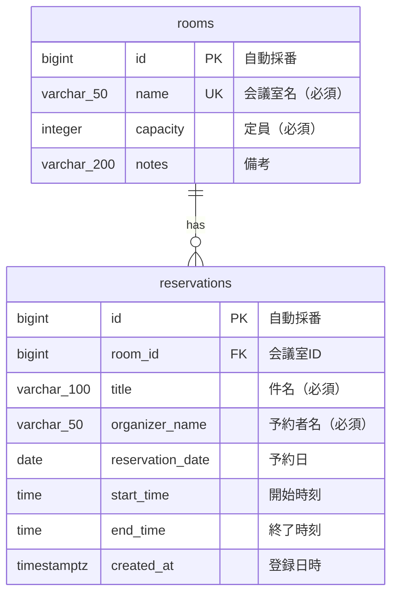

# 基本設計書 — 会議室予約システム

| 項目 | 内容 |
|---|---|
| 文書の位置づけ | 要件を「どういう画面・API・データ構造で実現するか」に落とし込む（外部設計） |
| 上位文書 | [02_要件定義.md](../../assignment/room/02_要件定義.md) |

## 1. システム構成

構成図は [../../images/architecture.png](../../images/architecture.png)（原本: [../../architecture.drawio](../../architecture.drawio)）を参照。  
SPA（React）+ REST API（Spring Boot）+ RDB（PostgreSQL）の3層構成とする。

## 2. 画面設計

### 画面一覧

| 画面ID | 画面名 | パス | 概要 | 対応機能 |
|---|---|---|---|---|
| S-01 | 予約状況・予約登録画面 | `/` | 日付ごとの全会議室の予約状況を表示し、予約登録・取り消しを行う | F-2、F-3 |
| S-02 | 会議室管理画面 | `/rooms` | 会議室の一覧表示・登録・編集・削除を行う | F-1 |

### S-01 画面項目・アクション

| 項目/操作 | 内容 | 呼び出すAPI |
|---|---|---|
| 日付選択 | 表示対象日を指定する | A-05 |
| 予約状況一覧 | 指定日の全会議室について、予約を開始時刻順に表示する | A-01、A-05 |
| 会議室選択 | 予約対象の会議室を選択する | A-01 |
| 予約フォーム | 件名・予約者名・日付・開始時刻・終了時刻を入力し、予約を登録する | A-07 |
| 会議室別予約一覧 | 選択した会議室の予約を日時順に表示する | A-06 |
| 取り消しボタン | 対象の予約を取り消す | A-08 |
| エラー表示 | API失敗時、画面上部にメッセージを表示する | — |

### S-02 画面項目・アクション

| 項目/操作 | 内容 | 呼び出すAPI |
|---|---|---|
| 会議室一覧 | 会議室名・定員・備考を表示する | A-01 |
| 登録フォーム | 会議室名・定員・備考を入力して登録する | A-02 |
| 編集操作 | 選択した会議室の情報を編集する | A-03 |
| 削除操作 | 会議室を削除する。進行中または未来の予約がある場合はエラーを表示する | A-04 |
| エラー表示 | API失敗時、画面上部にメッセージを表示する | — |

## 3. API設計

### API一覧

| API ID | メソッド | パス | 概要 | 正常時 | 対応機能 |
|---|---|---|---|---|---|
| A-01 | GET | `/api/rooms` | 会議室一覧取得 | 200 | F-1-2、F-2-1、F-3-1 |
| A-02 | POST | `/api/rooms` | 会議室登録 | 201 | F-1-1 |
| A-03 | PUT | `/api/rooms/{roomId}` | 会議室情報更新 | 200 | F-1-3 |
| A-04 | DELETE | `/api/rooms/{roomId}` | 会議室削除 | 204 | F-1-4 |
| A-05 | GET | `/api/reservations?date={date}` | 指定日の全会議室の予約状況取得 | 200 | F-3-1 |
| A-06 | GET | `/api/rooms/{roomId}/reservations` | 指定会議室の予約を日時順で取得 | 200 | F-3-2 |
| A-07 | POST | `/api/reservations` | 予約登録 | 201 | F-2-1〜F-2-4 |
| A-08 | DELETE | `/api/reservations/{reservationId}` | 予約取り消し | 204 | F-2-5 |

### 入出力（共通）

- A-02/A-03 リクエスト: `{ "name": string, "capacity": number, "notes": string|null }`
- A-07 リクエスト: `{ "roomId": number, "date": "YYYY-MM-DD", "startTime": "HH:mm", "endTime": "HH:mm", "title": string, "organizerName": string }`
- 会議室レスポンス: `{ "id": number, "name": string, "capacity": number, "notes": string|null }`
- 予約レスポンス: `{ "id": number, "roomId": number, "roomName": string, "date": "YYYY-MM-DD", "startTime": "HH:mm", "endTime": "HH:mm", "title": string, "organizerName": string }`
- A-05レスポンス: `[{ "roomId": number, "roomName": string, "reservations": [予約レスポンス] }]`。予約のない会議室も空の `reservations` で含める。
- A-06レスポンス: `[予約レスポンス]`
- エラー: `{ "message": string }` に統一する。入力不正は400、対象なしは404、重複予約・削除不可などの業務上の競合は409とする。

各項目の型・必須・文字数などの詳細は Swagger UI（`/api/docs`）を正とする。

## 4. データ設計

### ER図

カラムの詳細定義は、実装時に [04_詳細設計.md](./04_詳細設計.md) のテーブル定義書へ記載する。

## 5. 処理方式・設計判断

- **時間帯の重複判定**  
  同じ会議室・同じ日について、既存予約の `start_time < 新規予約の end_time` かつ `end_time > 新規予約の start_time` の場合に重複とする。開始時刻と終了時刻が接する予約は重複としない（例: 10:00〜11:00の次に11:00〜12:00を登録できる）。判定はServiceのトランザクション内で行う。

- **同時登録時の整合性**  
  予約登録時に対象会議室の行を悲観ロックし、そのロックを取得してから重複確認・登録を行う。同じ会議室への同時登録を直列化し、アプリケーション経由の登録で重複を防ぐ。異なる会議室の予約登録は独立して処理できる。

- **予約時間の単位**  
  任意の分単位で予約できる。画面は時刻入力を分単位で行い、丸め処理はしない。秒は扱わない。

- **日時の持ち方・日またぎ**  
  予約日は日付、開始・終了は時刻として別々に保持する。日またぎ予約は許可しない。終了時刻は開始時刻より後であることを登録時に検証する。過去判定には日本時間を用いる。

- **会議室削除と過去予約**  
  現在時刻より後に終了する予約（進行中または未来の予約）がある会議室は削除できない。削除可能な会議室に過去の予約が残っている場合、会議室とともに過去の予約も削除する。予約履歴の長期保存は今回の対象外とする。

- **一覧取得**  
  件数は研修アプリの想定規模を前提にページングなしとする。日付別一覧は会議室名、予約日時の順、会議室別一覧は日時順で返す。

## 6. 要件トレーサビリティ

| 要件 | 画面 | API |
|---|---|---|
| F-1-1 会議室登録 | S-02 | A-02 |
| F-1-2 会議室一覧 | S-02 | A-01 |
| F-1-3 会議室編集 | S-02 | A-03 |
| F-1-4 会議室削除 | S-02 | A-04 |
| F-2-1 予約登録 | S-01 | A-07 |
| F-2-2 終了時刻の検証 | S-01 | A-07 |
| F-2-3 重複予約の防止 | S-01 | A-07 |
| F-2-4 過去日時の予約防止 | S-01 | A-07 |
| F-2-5 予約取り消し | S-01 | A-08 |
| F-3-1 日付別の全会議室予約状況 | S-01 | A-01、A-05 |
| F-3-2 会議室別の予約一覧 | S-01 | A-06 |

元資料: [会議室システムの要求定義](../../assignment/room/01_要求定義.md)、[会議室システムの要件定義](../../assignment/room/02_要件定義.md)、記載形式の参考: [タスク管理アプリの基本設計](../task/03_基本設計.md)。
