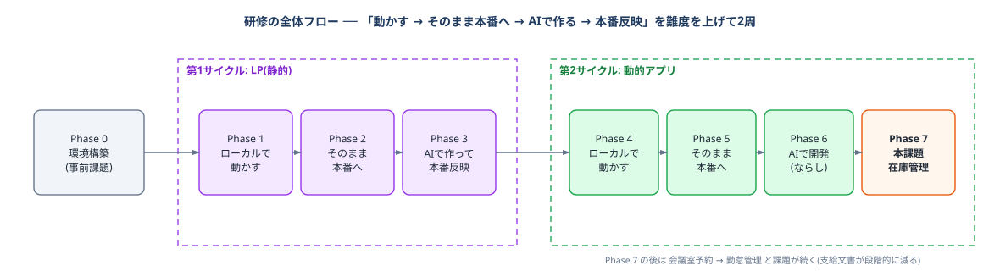

# 研修の進め方

この研修は「**動かす → そのまま本番に出す → AIで作る → 本番に出す**」という同じリズムを、**難度を上げて2周**します。
1周目は壊せない静的なLP、2周目はDB付きの動的アプリ。リズムが同じなので、2周目は「静的と動的の違い」だけに集中できます。

---

## Phase 0: 環境構築(事前課題)

[docs/setup.md](./setup.md) を実施し、`bash scripts/doctor.sh` が**全項目OK**になるまで進めてください。所要2〜3時間。研修当日までに完了していることが前提です。

**完了条件**: doctor.sh 全項目OK / Claude Code にログイン済み

---

# 第1サイクル: LP(静的)

## Phase 1: LPをローカルで動かす

1. テンプレートから自分のリポジトリを作成し、`~/projects` 配下に **git clone** する(setup.md 手順9)
2. サンプルLPをローカルで表示する: `python3 -m http.server 3000 --directory lp/site` → http://localhost:3000
3. 中身を見る: 実体は `lp/site/` のHTMLとCSSだけ。**サーバーで実行されるプログラムが無い=静的サイト**であることを確認する
4. [CLAUDE.md](../CLAUDE.md) の「LP(lp/site)」のルールを読む(静的HTML/CSSのみ。JS・フレームワーク禁止)

**完了条件**: サンプルLPを手元で表示できた / 「静的」の意味を説明できる

## Phase 2: LPをそのまま本番へ(初リリース)

**コードを1行も変えずに**、サンプルLPを世界に公開します。[docs/deploy-lp.md](./deploy-lp.md) に従い、本番サーバーの土台ごと構築します。

1. Lightsail作成(2GBプラン)+ 静的IP + ファイアウォール
2. DNS設定(入口・アプリ用・LP用の**Aレコード3本**を運営に払い出し依頼)
3. サーバー初期設定(スワップ・Docker・clone・.env)
4. certbotで**3ドメインを1枚の証明書**として取得
5. LP公開 → `https://lp.<自分のドメイン>` にサンプルLPが表示される 🎉

**完了条件**: サンプルLPがHTTPSで公開されている(無変更で本番まで通した)

> 学び: 無変更で先に一周することで環境の問題を全部潰す。以降のエラーは「自分の変更が原因」と即断できる。静的サイトの公開に必要なのは「Webサーバーと証明書」だけ。

## Phase 3: LPをAIで作って本番反映

**最初のAI開発課題です。** サンプルLPを、Claude Code に指示して自分のLPに作り替えます。

1. ブランチを切り、Claude Code に指示する。指示例:

   > lp/site/ のサンプルを参考に、タスク管理アプリ「TaskBoard」の紹介LPを**新規に**作り直して。CLAUDE.md のLPルール(静的HTML/CSSのみ)を守ること。構成はヒーロー・特徴3つ・使い方・CTAとし、配色やコピーは自分らしくアレンジしてよい。**アプリへのリンクボタンは href="#" のままにしておく**(Phase 6 で本番URLに差し替えるため)

2. ローカルでプレビューし、**差分で指示を重ねて**納得いくまで改善する(「文言を短く」「配色を暖色に」等)
3. PR → マージ([git-commands.md](./git-commands.md) のGitフローに慣れる)
4. サーバーで反映する: `git pull` のみ(マウント配信のためビルド・再起動不要)
5. `https://lp.<自分のドメイン>` に**自分のLP**が表示されることを確認する

**完了条件**: 自作LPが本番公開されている / AIへの指示を重ねて改善できた

> 学び: 「AIに作らせる→レビューする→直させる」というAI開発の基本サイクル。静的サイトの更新は pull だけで済むこと。

---

# 第2サイクル: 動的アプリ

## Phase 4: アプリをローカルで動かす

1. DBを起動する: `docker compose up -d`
2. backend / frontend を起動する(手順は [README.md](../README.md))
3. http://localhost:5173 でタスクの**追加・完了・削除**を操作する
4. http://localhost:8080/api/docs で Swagger UI を眺め、画面の操作とAPIの対応を確認する
5. [CLAUDE.md](../CLAUDE.md) 全体を読む(以降のAI開発の全ルール)

**完了条件**: 画面からCRUDを一通り操作できた / CLAUDE.md を読了

## Phase 5: アプリをそのまま本番へ

LPと同じく、**コードを変えずに**まず一旦デプロイします。[docs/deploy.md](./deploy.md) に従い、Phase 2 で作ったサーバーに追加公開します。

1. デプロイ前確認: `docker compose -f docker-compose.prod.yml up --build` をローカルで一周
2. サーバーで構成を切り替え(LP専用 `lp.yml` を down → 本番 `prod.yml` を up --build)
3. `https://app.<自分のドメイン>` でアプリ、`https://lp.<自分のドメイン>` でLP、**2サイトの同居**を確認する(`https://<自分のドメイン>` はLPへリダイレクト)

**完了条件**: アプリとLPが同一サーバーでHTTPS公開されている(無変更で通した)

> 学び: 動的アプリには**サーバープロセス+DB**が必要になる(静的との違い)。1つのnginxがドメイン名で配信先を振り分ける(バーチャルホスト。現場頻出)。

## Phase 6: アプリをAIで開発して本番反映(ならし)

本課題の前に、動的アプリでのAI開発サイクルを小さく一周します。あわせてLPとアプリを接続します。

1. タスク管理アプリの設計書一式([docs/design/task/](./design/task/))を読み、**各文書とコードの対応**を確認する(API一覧 ⇔ TaskController、ER図 ⇔ Flywayマイグレーション)
2. [architecture-guide.md](./architecture-guide.md) の「新機能追加のレシピ」を読む
3. Claude Code に機能追加(推奨: **タスクに期限 due_date を追加**)を指示する
   - 「先にAPI設計とDB変更案を提示して。実装はまだしない」→ 合意してから実装+テスト
   - **設計書(API一覧・ER図・テーブル定義)も更新させる**
4. LPのアプリ導線ボタン(`href="#"`)を自分のアプリ本番URLに差し替える
5. PR → **CIが緑になること**を確認 → マージ → サーバーで反映(`git pull` + `up -d --build`)→ 本番確認

**完了条件**: 期限機能が本番で動作 / 設計書とコードが一致 / LPからアプリに飛べる / 修正→PR→CI→デプロイ→確認を自力で一周できた

## Phase 7: 本課題 — 在庫管理アプリを上流からAIで開発

**ここから課題ごとに新しいリポジトリで進めます。** テンプレート `training-stock`(基盤+課題文書のみ。実装なし)から自分のリポジトリを作成し、タスク管理と同じアーキテクチャで在庫管理アプリをゼロから構築します([repos-guide.md](./repos-guide.md) の手順)。
要求定義・要件定義は課題リポの `docs/assignment/` に支給済みです。受講者は**基本設計からAIと共に作成**します。これはSESの実務(上流成果物を受け取って下流を作る)の再現です。

0. **課題リポの作成**: `training-stock` から Use this template で自分のリポ(例: `training-yamada-stock`)を作り、`~/projects` に clone する。お手本(タスク管理)のコードを参照するため、`training-task` も隣に clone しておく(repos-guide.md §5)
1. **要求・要件の読み込み**: 課題リポの `docs/assignment/` にある要求定義・要件定義を読む。不明点は講師に質問する(実務でいう要件QA)
2. **基本設計の作成(AIと共同)**: `docs/design/stock/` を作成し、[design/task/03_基本設計.md](./design/task/03_基本設計.md) と同じ構成で書く
   - 指示例: 「docs/assignment/stock/ の要求・要件定義を読み、docs/design/task/03_基本設計.md と同じ形式で在庫管理の基本設計を作成して。要件の論点(在庫数の算出方式)には設計判断と理由を記載して」
   - AIの出力を**鵜呑みにせずレビュー**する。要件との対応漏れ・画面とAPIの不整合を見る
3. **講師レビュー**: 基本設計をPRで提出し、承認を得てから実装に入る(手戻り防止)
4. **実装**: [architecture-guide.md](./architecture-guide.md) のレシピに従い、機能単位(品目マスタ → 入出庫 → 在庫照会)で小さくPRを分ける。実装・テストはお手本(training-task)の型を模倣する
5. **詳細設計の反映**: テーブル定義等を `docs/design/stock/04_詳細設計.md` に反映([design/task/04_詳細設計.md](./design/task/04_詳細設計.md) と同じ「薄い詳細設計」方針)
6. **サーバーの作り直しと公開**: 本課題の公開前に**サーバーをクリーンに作り直します**([server-rebuild.md](./server-rebuild.md)。Phase 2 でやった構築の反復 = 2回目なので30分程度で終わるはず)。作り直したサーバーには**この課題のリポを clone** して deploy-lp.md → deploy.md の流れで公開する(本番は常に1課題のみ公開)
7. **デプロイ**: 機能ごとに `git pull` + `up -d --build` で本番反映。LPも在庫管理の紹介に書き換える(AIなら短時間でできる)

### 評価の観点

- 要件と基本設計の対応が取れているか(要件の見落としがないか)
- タスク管理と同じ型(パッケージ構成・レイヤー・API規約・テスト)を踏襲できているか(ArchUnit/CIが緑)
- AIへの指示が適切か(設計を先に固めているか、PRにプロンプトが記録されているか)

**完了条件**: 在庫管理の3機能が本番で動作 / 設計書一式が揃っている / CIが緑

---

## Phase 8以降: 会議室予約・勤怠管理(課題の反復)

Phase 7 と同じ流れを、支給文書を減らしながら反復します(課題リポは `training-room` → `training-attendance`)。

| 課題 | 支給 | 受講者が作る範囲 |
|---|---|---|
| 会議室予約(training-room) | 要求定義+要件定義 | 基本設計 → コード |
| 勤怠管理(training-attendance) | **要求定義のみ** | **要件定義** → 基本設計 → コード |

各課題とも、公開前のサーバー作り直し([server-rebuild.md](./server-rebuild.md))と、LPをその課題の紹介に書き換えるところまで含めて一周です。
